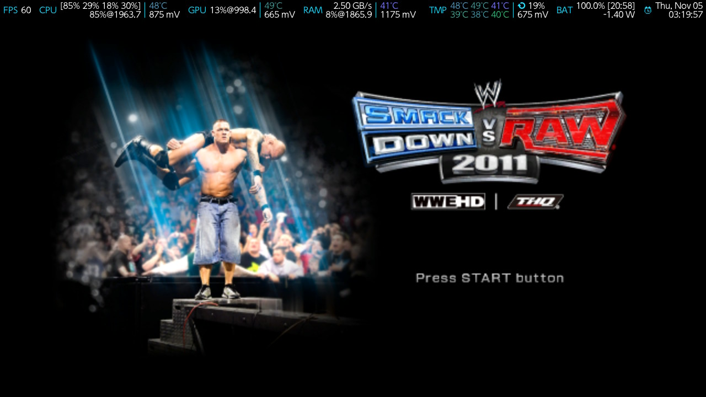
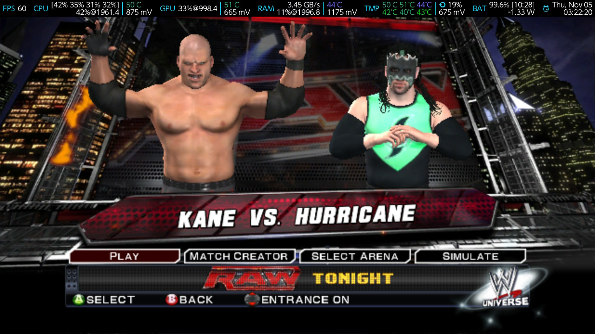

# SVR2011-NX

**WWE SmackDown vs. Raw 2011 - Nintendo Switch homebrew port (work in progress).**

This is a native Nintendo Switch homebrew port of the Xbox 360 version of
*WWE SmackDown vs. Raw 2011*. It is not an emulator: the game's PowerPC code
is statically recompiled to C++ with [ReXGlue](https://github.com/rexglue/rexglue-sdk)
and compiled for the Switch with devkitA64/libnx. The native renderer on
`main` draws through Vulkan on [Mesa NVK](https://github.com/danfromtico/mesa-switch);
this `deko3d` branch replaces that backend with the Switch's own deko3d API.
The deko3d work is tracked in [docs/DEKO3D.md](docs/DEKO3D.md), with the
source-only release notes in [docs/RELEASE-deko3d.md](docs/RELEASE-deko3d.md).

The port is based on the public
[WWE SmackDown vs. Raw 2011 PC port](https://github.com/KaikoClanworth1/wwe-svr2011-pc)
by KaikoClanworth1 and contributors, and on the Horizon (Switch) layer of the
public NFSMW-NX and SA2-NX ReXGlue ports.

> **Status: work in progress, playable on hardware.** The `deko3d` branch
> builds an 82 MB `svr2011.nro`, boots, loads saves and runs a 1v1 match at
> **~35 fps in-ring on the overclocked console (~33 fps at stock clocks,
> 60 Hz game logic)**. The `main` NVK build is ~20 fps. The remaining limit is
> the guest main thread; FSR 1 was measured slower in the full-screen present
> build, so the measured profile uses no FSR at a 0.5 scene (see
> [docs/performance-svr2011.toml](docs/performance-svr2011.toml)). Save
> creation on the console is still unreliable; a folder save made by the PC
> build loads correctly. See [docs/PORTING_PLAN.md](docs/PORTING_PLAN.md) and
> [docs/TESTING.md](docs/TESTING.md).

---

## No game material

This repository contains **no game data and no recompiled game code**.

You need your own legally obtained Xbox 360 copy of *WWE SmackDown vs. Raw
2011* (the USA/Europe multi-language disc image, or its extracted
`default.xex` and game files). The NRO is generated locally from that copy.
The release artifacts for this project are source and build/installer tools,
not a playable NRO containing the game.

Do not open issues or pull requests that attach an ISO, `default.xex`, game
files, shader packs, textures, audio, video, or a prebuilt NRO. Maintainer
screenshots of the running port live in [docs/screenshots/](docs/screenshots/)
as documentation only, not as project assets. See
[docs/LEGAL.md](docs/LEGAL.md).

## Release model

The public release is a **builder, not a playable NRO**. The NRO contains the
recompiled game code generated from `default.xex`, so distributing it would
distribute the game's code even if all assets were streamed from the user's
folder. The release contains the source and the one-click builder; the user's
PC produces the NRO from their own game folder. See
[docs/DISTRIBUTION.md](docs/DISTRIBUTION.md).

---

## What works

| Area | State |
|---|---|
| Source import from the PC port (MIT) | Done |
| Horizon (Switch) ReXGlue SDK layer | Imported (BSD-3-Clause) |
| Build scaffolding and third-party fetch | Done |
| Host code generator (`rexglue`) from the user's `default.xex` | Done (403 generated files) |
| Switch portlibs + deko3d/uam + NVK (emulated GPU) build | Done (compiles) |
| Switch NRO target | **Builds** (82 MB `svr2011.nro` on the deko3d branch) |
| deko3d backend + NWindow presentation | Works on hardware: 2D/3D/cube shaders, resolves, present |
| Mesa/NVK + Vulkan presentation (`main`) | Works on hardware (the ~20 fps reference) |
| Boot to the main menu | Works |
| Match, audio, input | Works: 1v1 match loads and plays; attacks and movement work |
| Saves | A PC-made folder save loads (4.2 MB); creating a save on the console is still slow/unreliable |
| deko3d shader conversion | 926 SPIR-V variants converted, 0 skipped (`tools/deko3d_shaders.py`) |
| Performance (deko3d, 60 Hz logic) | **~35 fps in-ring overclocked / ~33 fps stock** at the 0.5 no-FSR profile; NVK `main` ~20 fps |
| FSR 1 | Implemented; measured slower (~25 fps) than the no-FSR profile on the full-screen present path |
| DLC | The port's fake Fan Axxess package hangs the DLC loader; `dlc_fan_axxess = false` |
| Folder-based Windows builder | Done, tested end-to-end (`Build SVR2011-NX.cmd`) |
| Source-only release packaging | Done (`tools/package_release.ps1`) |

---

## Screenshots

The deko3d build running on Switch hardware (handheld, 60 fps menus; the
system overlay at the top shows the overclocked clocks):

| Title screen | Match select |
|:---:|:---:|
|  |  |

More in [docs/screenshots/](docs/screenshots/). They are documentation only,
not game data used by the build; the release guard allows images only in that
folder.

---

## Requirements

- A Nintendo Switch 1 (Erista or Mariko) with Atmosphère/homebrew support.
  Switch 2 homebrew is a separate, less mature target and is not covered here.
- Your own Xbox 360 copy of the game and a way to read it (ISO or extracted
  files). About 5.4 GB of game data plus the ISO.
- A microSD card with enough free space (8 GB minimum; 16 GB recommended).
- A PC with:
  - WSL2 Ubuntu 24.04/26.04 or a Linux machine (the build scripts target
    Linux; Windows-native builds are possible but not documented yet).
    Ubuntu 22.04 needs a newer Clang than its default for the C++23 host tool.
  - devkitPro with devkitA64, libnx and the Switch tools.
  - CMake 3.25+, Ninja, Git, Python 3.10+, Clang/GCC.
  - 32 GB RAM recommended for the LTO build of the recompiled game.
  - For Mesa/NVK: the Mesa build prerequisites (Meson, Ninja, Rust, bindgen,
    cbindgen, flex, bison, pkg-config).
- A title override (hold **R** while starting an installed game) or a
  forwarder with a **39-bit address space**. Album applet mode does not give
  the game enough memory.

---

## Build overview

On Windows, extract the release and run `Build SVR2011-NX.cmd`; it asks for
your extracted game folder and produces the NRO and an SD-card folder. It
needs WSL2 with Ubuntu and devkitPro (the script checks and explains what is
missing). The full instructions are in [docs/BUILDING.md](docs/BUILDING.md)
and [docs/DISTRIBUTION.md](docs/DISTRIBUTION.md).

The manual WSL/Linux build is:

```sh
# 1. Fetch the ReXGlue third-party sources (not committed)
python3 tools/fetch_thirdparty.py

# 2. Build the Switch portlibs (zlib, expat, zstd) into devkitPro
sudo tools/build_portlibs.sh

# 3. Build Mesa/NVK for the Switch (see docs/BUILDING.md)
#    and set REXGLUE_SWITCH_NVK_SDK to its portlibs/switch folder.

# 4. Put your own default.xex in port/assets/ (ignored by git)
cp /path/to/your/game/default.xex port/assets/default.xex

# 5. Build the host code generator and generate the game C++
tools/build_switch.sh --codegen

# 6. Build the NRO (once the Switch target is wired)
tools/build_switch.sh --switch
```

The first build is long. The game's recompiled code is large, and the final
LTO link needs a lot of RAM. The first start on the console also compiles
graphics pipelines; expect a stutter while the shader cache fills.

---

## SD card layout

On Windows, `tools/stage_sd.ps1` assembles this folder from your PC install
(see [docs/TESTING.md](docs/TESTING.md)). The target layout is:

```text
sdmc:/switch/svr2011/
  svr2011.nro              the program (built locally)
  svr2011.toml             settings (written on first start if missing)
  default.xex              your game's executable (user-supplied)
  pac/                     game data (user-supplied)
  sound/                   game data (user-supplied)
  movies/                  game data (user-supplied)
  plist360.arc             game data (user-supplied)
  plist360_4x3.arc         game data (user-supplied)
  native_shaders/          generated from your own game, or copied from
                           your own PC install (user-supplied)
  pad_icons/               optional, from your own PC install
  Saves/                   created by the game
  Mods/                    optional, user-supplied .svrmod files
  DLC/                     optional, user-supplied DLC
  Music/                   optional, user-supplied entrance music
  Custom Movies/           optional, user-supplied entrance movies
```

Do not redistribute this folder. It contains game data.

---

## Controls

The Switch port uses the game's Xbox 360 control layout. Set
`input_xbox_layout` in `svr2011.toml`:

- `true` (recommended): buttons by position, as on an Xbox pad — the Switch
  bottom button (B) is Xbox A, the right button (A) is Xbox B, the left (Y)
  is Xbox X, the top (X) is Xbox Y.
- `false`: by letter — Switch A is Xbox A, B is B, X is X, Y is Y.

The in-game menus, entrances and matches use the original game prompts.

---

## Credits and licences

See [THIRD_PARTY_NOTICES.md](THIRD_PARTY_NOTICES.md) and [LICENSE](LICENSE).

The port's own code is MIT. The ReXGlue SDK and the Horizon layer are
BSD-3-Clause. plume is MIT. Mesa/NVK is MIT. deko3d is zlib. The Bink
reader/writer is LGPL-2.1-or-later. No game material is covered by any of
these licences.

This is an unofficial fan project. It is not affiliated with or endorsed by
WWE, THQ, Yuke's, Microsoft or Nintendo.
